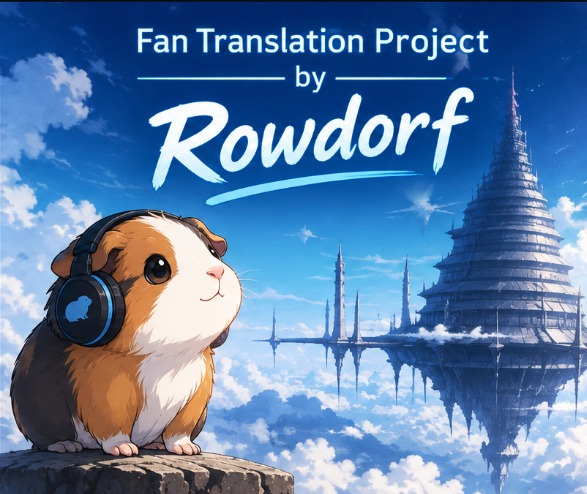
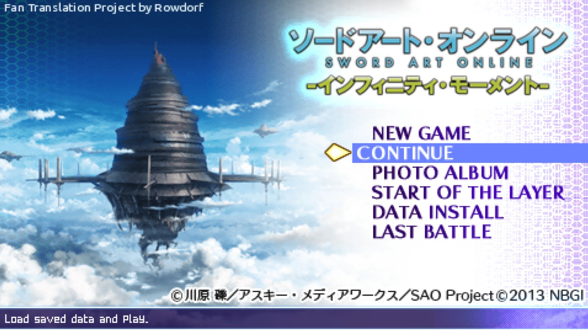
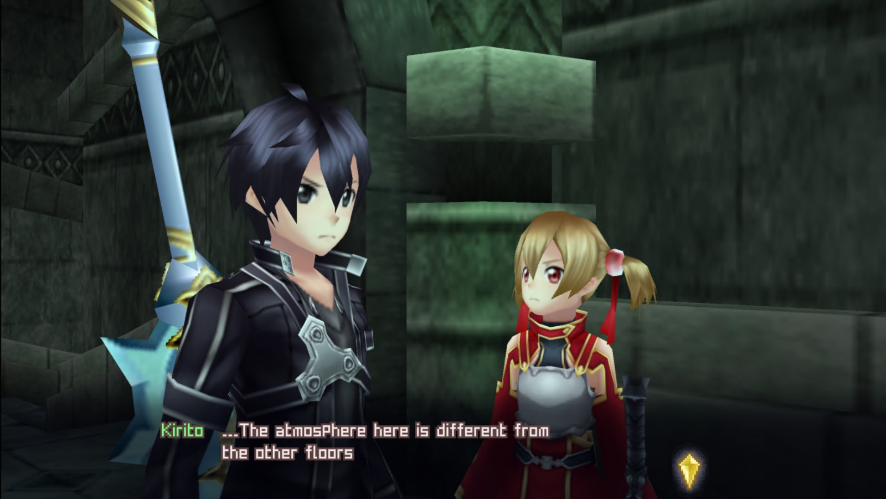
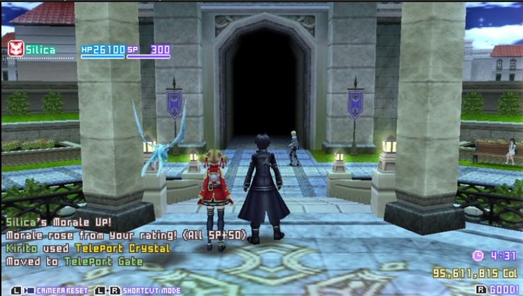
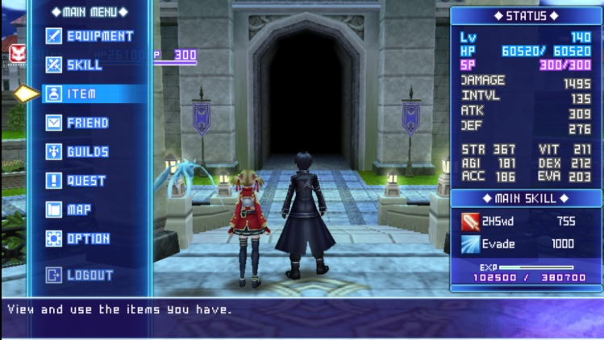
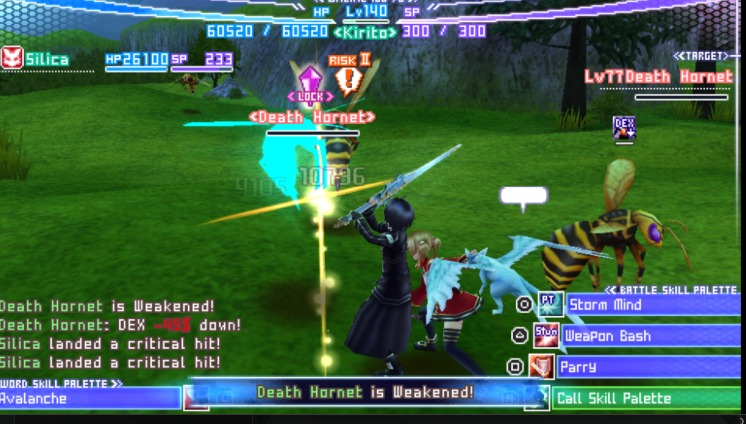

<p align="center">
  
</p>

# RowdyTranslation v0.9 beta — Sword Art Online: Infinity Moment (PSP) in English

**Fan Translation Project by Rowdorf**

<p align="center">
  
  
</p>
<p align="center">
  
  
</p>
<p align="center">
  
</p>

An English fan translation of *Sword Art Online: Infinity Moment* (PSP, Japan, NPJH50701). It is distributed
**only as a patcher**: you need your own Japanese ISO. **This project does not distribute the game or any game
files.** Please buy the original game.

> **This is the first public beta.** All text lines are translated and pass automatic checks, but most of them have
> not been read inside the game yet. Expect odd lines, overflowing text or untranslated spots — please report them
> in [Issues](https://github.com/rowdorfin/RowdyTranslation/issues). Fix releases will follow.

## Download
Get `RowdyTranslationV0.9-beta.zip` from the [Releases](https://github.com/rowdorfin/RowdyTranslation/releases)
page. This repository and its releases are the **only** official distribution.

## Requirements
- Windows 10 or 11 (64-bit). Nothing to install (uses the .NET Framework 4.8 built into Windows). Works offline.
- Your original, unmodified Japanese ISO:

| field | expected value |
|---|---|
| game | Sword Art Online: Infinity Moment (PSP, Japan) |
| ID | NPJH-50701 (v1.00) |
| size | 1,200,226,304 bytes |
| SHA-256 | `c8797943ee17f0b2b8e8b8bffdfd1189c75a569c90c5eed62722901d95f95ac4` |

- About 2.3 GB free on the drive where the translated ISO is saved.
- To play: a PSP with custom firmware (ARK-4, PRO or ME) or the PPSSPP emulator.

A Linux/macOS patcher is not available in this version.

## How to use
1. Extract the `.zip` and run **RowdyTranslationV0.9-beta.exe**.
2. Click **Select ISO...** and pick your original Japanese ISO.
3. Check/choose the output file with **Choose destination...** (default: same folder as the ISO).
4. Click **Apply translation** and wait 1–3 minutes.
5. Done: the translated ISO (~2.2 GB) is verified by SHA-256 before the success message. Your original ISO is never
   modified.

## Verifying the download
The executable is **not digitally signed**, so Windows SmartScreen/Defender may warn about it. Compare the SHA-256
with `SHA256SUMS-release.txt` on the release page:
```
certutil -hashfile RowdyTranslationV0.9-beta.exe SHA256
```

## Troubleshooting
| message | what to do |
|---|---|
| "not an ISO image" | Select the Japanese ISO (NPJH50701). CSO/ZIP/7z are not accepted: extract first. |
| "different SHA-256" / "size ... expected ..." | Your ISO is modified or a different dump/version (e.g. an already translated ISO). Use a clean dump. |
| "Not enough space" | Free about 2.3 GB or pick another drive. |
| "No permission to write" | Pick a folder of your own (Documents, Desktop), not `C:\Windows` or `Program Files`. |
| "patch data is corrupted" | Download the zip again and check the hash. |
| Old/Japanese text in the game | If you used the game's **Data Install** before, delete the old install data (`PSP/SAVEDATA/NPJH50701INSTALL`) and install again. Saves can stay. |
| Anything else | Click **Open log** and attach `%LOCALAPPDATA%\RowdyTranslation\RowdyTranslation.log` to an Issue. |

The translated game needs custom firmware or PPSSPP; it does not run on a PSP without CFW.

## Known issues (v0.9 beta)
- Text drawn inside images or videos is still Japanese: the opening captions, the character registration dialog,
  the boot notice, some STATUS and FRIEND labels and the ○/R answer buttons shown in some conversations.
- The title logo is kept as the original Japanese artwork.
- Some menu labels are abbreviated to fit fixed-size fields (e.g. "2HSwd", "Kat.", "1H Sword").
- Most lines have not been checked in-game yet.

## Help improve the translation!

This is an early public beta, and community feedback is a big part of the next stage of development. If you play through the game, please report untranslated text, awkward translations, text overflow, or unexpected behavior.

I'm also looking for advanced game saves or emulator save states. So far, I haven't been able to find a save that reaches the higher floors of Aincrad, which makes it difficult to test the translation throughout the game. If you've progressed further, I'd really appreciate it if you could share your save file or emulator save state so we can test those sections and fix any issues together.

Screenshots and the exact location of an issue (floor, area, menu, or event) are especially helpful. Every report helps make the next release better!

Report an issue on GitHub

## Support Rowdorf

Enjoying this project? You can support my translation work and future fan projects through voluntary donations.

☕ [**Support Rowdorf on Ko-fi**](https://ko-fi.com/SEU_USUARIO_KOFI)

Have an idea for a new project, a game you'd love to see translated, or something you'd really like me to work on? Feel free to leave a donation with a message sharing your suggestion! I'd love to hear your ideas and discover which projects the community would like to see in the future.

Every contribution is appreciated, but donations are completely optional. You can also share your suggestions through [GitHub Issues](https://github.com/rowdorfin/RowdyTranslation/issues).

Thank you for your support! Every contribution and suggestion helps inspire future projects.

## Credits
- Translation, patch and patcher: **Rowdorf** (with AI assistance).
- References consulted: the official English localization of *SAO: Hollow Fragment* (terminology);
  **HoaiTrung97**'s earlier English fan translation; the hatsunumike.blogspot.com floor guides (area names).
- *Sword Art Online* © Reki Kawahara / KADOKAWA / SAO Project; game © BANDAI NAMCO Games. Non-profit fan project,
  not affiliated with the rights holders.

## License
**All rights reserved.** See [LICENSE](LICENSE). Redistribution, modification, extraction or reuse of the
translation, patch or patcher, in whole or in part, is prohibited without written permission.
