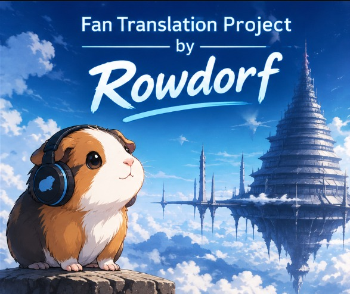
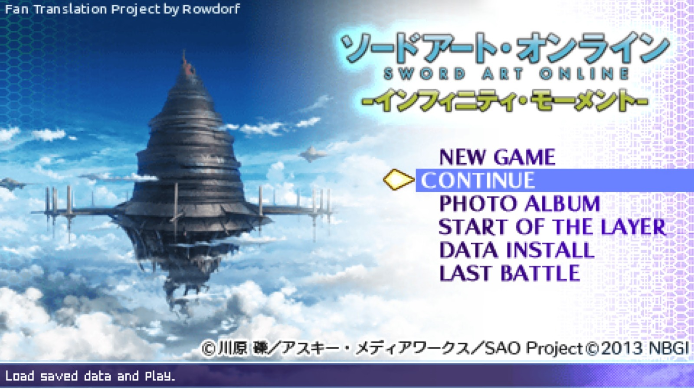
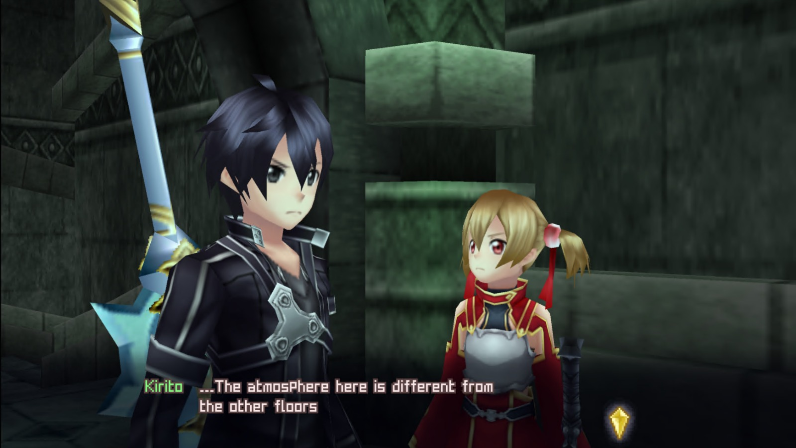
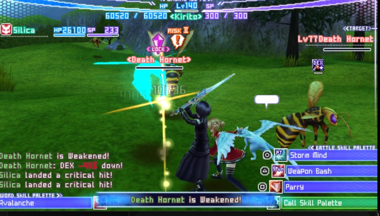
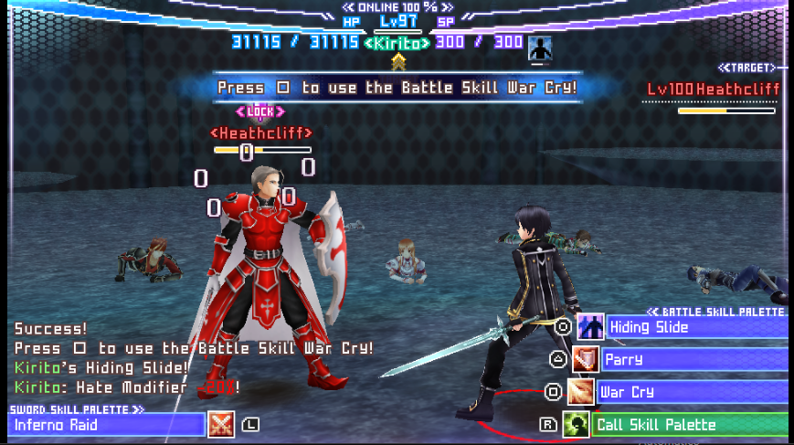
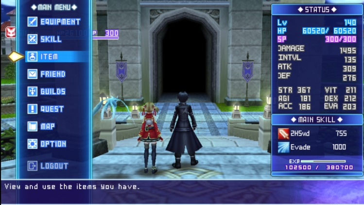
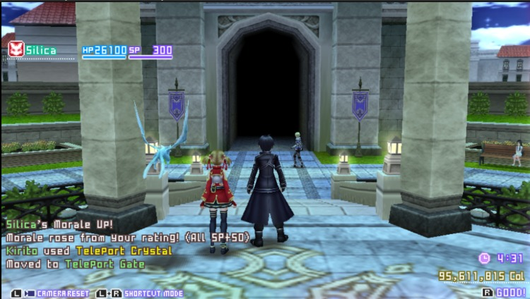

<p align="center">
  
</p>

<h1 align="center">RowdyTranslation v1.0</h1>

<p align="center">
  <b>Sword Art Online: Infinity Moment (PSP) — fan translation into English and Brazilian Portuguese</b><br>
  <sub>Fan Translation Project by Rowdorf</sub>
</p>

<p align="center">
  <a href="https://github.com/rowdorfin/RowdyTranslation/releases/latest"></a>
  
  
  
</p>

<p align="center">
  <a href="https://github.com/rowdorfin/RowdyTranslation/releases/latest"></a>
</p>

<p align="center"><b>English</b> · <a href="README.pt-BR.md">Português (BR)</a></p>

---

Play the Japan-only PSP game *Sword Art Online: Infinity Moment* (NPJH50701) in **English** or
**Brazilian Portuguese**. The game text, menus, system dialogs and movie subtitles are translated, and both
languages ship in a single patcher for Windows, Linux and macOS.

> [!IMPORTANT]
> This is **a patcher only**. You need your own original Japanese ISO. **This project does not distribute the game
> or any game files.** Please buy the original game.

## Screenshots

<table>
  <tr>
    <td width="50%"></td>
    <td width="50%"></td>
  </tr>
  <tr>
    <td align="center"><sub>Title screen</sub></td>
    <td align="center"><sub>Story dialogue</sub></td>
  </tr>
  <tr>
    <td></td>
    <td></td>
  </tr>
  <tr>
    <td align="center"><sub>Battle and skill palettes</sub></td>
    <td align="center"><sub>Boss battle</sub></td>
  </tr>
  <tr>
    <td></td>
    <td></td>
  </tr>
  <tr>
    <td align="center"><sub>Main menu and status</sub></td>
    <td align="center"><sub>Field messages</sub></td>
  </tr>
</table>

## What's new in v1.0
- New **Brazilian Portuguese** translation, alongside English.
- Movie subtitles drawn by the game itself (original videos untouched).
- Many in-game fixes from testing on PSP and PPSSPP: menus, buttons, shop/blacksmith labels, partner speech bubbles
  (no longer cut at 19 characters), boss result screen, system dialogs.
- Patchers for Windows, Linux and macOS; the translated ISO is now ~1.3 GB (was ~2.2 GB).

Full list in the [CHANGELOG](CHANGELOG.md).

## Download
Get the package for your system from the **[latest release](https://github.com/rowdorfin/RowdyTranslation/releases/latest)**.
This repository and its releases are the **only** official distribution; any other copy may be modified.

| System | File | Interface |
|---|---|---|
| Windows 10/11 | `RowdyTranslationV1.0.zip` | window, nothing to install |
| Linux (x64 / ARM64) | `RowdyTranslationV1.0-linux.tar.gz` | terminal |
| macOS (Intel / Apple Silicon) | `RowdyTranslationV1.0-macos.zip` | terminal |

Both languages are inside every package; you pick one when patching. Works offline.

## Requirements
Your **original, unmodified Japanese ISO**:

| Field | Expected value |
|---|---|
| Game | Sword Art Online: Infinity Moment (PSP, Japan) |
| ID | NPJH-50701 (v1.00) |
| Size | 1,200,226,304 bytes |
| SHA-256 | `c8797943ee17f0b2b8e8b8bffdfd1189c75a569c90c5eed62722901d95f95ac4` |

CSO, ZIP and 7z files are not accepted: extract the ISO first. You also need about **1.4 GB** of free space where the
translated ISO is saved.

## How to patch
The patcher checks your ISO by size and SHA-256, **never modifies the original**, and verifies the new ISO by SHA-256
before finishing. To have both languages, run it twice and save two ISOs.

<details open>
<summary><b>Windows</b></summary>

1. Extract the `.zip` and run **RowdyTranslationV1.0.exe**.
2. Pick the language at the top: **English** or **Português (BR)**.
3. **Select ISO...** → your original Japanese ISO. **Choose destination...** → where to save.
4. Click **Install English translation** and wait a few minutes.

</details>

<details>
<summary><b>Linux</b></summary>

Extract the `.tar.gz` and run the program in a terminal (`-linux-x64` for a regular PC, `-linux-arm64` for 64-bit ARM).
It asks for the language and the files; you can drag the ISO into the terminal.

```bash
./RowdyTranslationV1.0-linux-x64
```

Or pass everything at once (`--lang en` or `--lang pt`):

```bash
./RowdyTranslationV1.0-linux-x64 --lang en original.iso SAO_IM_EN_v1.0.iso
```

If it says "permission denied", run `chmod +x RowdyTranslationV1.0-linux-x64` first.

</details>

<details>
<summary><b>macOS</b></summary>

1. Unzip and double-click **RowdyTranslationV1.0.command**. It opens in Terminal and asks for the language and the
   files (drag the ISO into the Terminal window and press Enter).
2. The app is **not notarized by Apple**. If macOS refuses to open it: right-click it > **Open** > **Open**, or
   System Settings > Privacy & Security > **Open Anyway**. Or, in Terminal, once:
   ```bash
   xattr -d com.apple.quarantine RowdyTranslationV1.0.command
   ```
3. Terminal use also works: `./RowdyTranslationV1.0.command --lang en original.iso SAO_IM_EN_v1.0.iso`.

</details>

Each package also includes its own README.

### Verifying the download
The programs are **not digitally signed**, so Windows SmartScreen/Defender or macOS Gatekeeper may warn about them.
Compare the SHA-256 with `SHA256SUMS-release.txt` on the release page:

```bash
certutil -hashfile RowdyTranslationV1.0.exe SHA256
```

On Linux use `sha256sum`; on macOS, `shasum -a 256`.

## Compatibility
- **PSP** with custom firmware (ARK-4, PRO or ME). The translated game does **not** run on a PSP without CFW.
- **PPSSPP** emulator.
- Movie subtitles are compatible with CWCheat codes.

If you used the game's **Data Install** before patching, delete the old install data
(`PSP/SAVEDATA/NPJH50701INSTALL`) and install again. Your saves can stay.

<details>
<summary><b>Troubleshooting</b></summary>

| Message | What to do |
|---|---|
| "not an ISO image" | Select the Japanese ISO (NPJH50701). CSO/ZIP/7z are not accepted: extract first. |
| "different SHA-256" / "size ... expected ..." | Your ISO is modified or a different dump/version (e.g. an already translated ISO). Use a clean dump. |
| "Not enough space" | Free about 1.4 GB or pick another drive. |
| "No permission to write" | Pick a folder of your own (Documents, Desktop), not `C:\Windows` or `Program Files`. |
| "patch data is corrupted" | Download the package again and check the hash. |
| Old/Japanese text or the other language in the game | Delete the old Data Install (`PSP/SAVEDATA/NPJH50701INSTALL`) and install again. Saves can stay. |
| Anything else | Attach the log to an Issue (see [Reporting bugs](#reporting-bugs)). |

Log files: Windows `%LOCALAPPDATA%\RowdyTranslation\RowdyTranslation.log` (**Open log** button),
Linux `~/.cache/RowdyTranslation/RowdyTranslation.log`, macOS `~/Library/Caches/RowdyTranslation/RowdyTranslation.log`.

</details>

## Known issues (v1.0)
- Text drawn inside the videos (the character registration box, the boss room sign) stays Japanese.
- The title logo is kept as the original Japanese artwork.
- Some menu labels are abbreviated to fit fixed-size fields (e.g. "2HSwd", "Kat.", "1H Sword").

## Reporting bugs
Found untranslated text, an awkward line, text overflowing a box or anything unexpected? Please open an
**[Issue](https://github.com/rowdorfin/RowdyTranslation/issues)**. The most helpful reports include:
- the **language** (English or Português) and where you play (**PSP with CFW** or **PPSSPP**);
- the exact **location**: floor, area, menu or event;
- a **screenshot**;
- for patcher problems, the **log file** (paths under Troubleshooting).

Every report helps make the next release better!

## Support Rowdorf
Enjoying this project? You can support my translation work and future fan projects through voluntary donations.

<p align="center">
  <a href="https://ko-fi.com/rowdorf"></a>
</p>

Have an idea for a new project or a game you'd love to see translated? Leave a donation with a message, or share it
through [GitHub Issues](https://github.com/rowdorfin/RowdyTranslation/issues). Donations are completely optional.

## Credits
- Translation (English and Brazilian Portuguese), patch and patcher: **Rowdorf** (with AI assistance).
- References consulted: the official English localization of *SAO: Hollow Fragment* (terminology);
  **HoaiTrung97**'s earlier English fan translation; the hatsunumike.blogspot.com floor guides (area names).
- *Sword Art Online* © Reki Kawahara / KADOKAWA / SAO Project; game © BANDAI NAMCO Games. Non-profit fan project,
  not affiliated with the rights holders.

## License
**All rights reserved.** See [LICENSE](LICENSE). Redistribution, modification, extraction or reuse of the
translation, patch or patcher, in whole or in part, is prohibited without written permission. Selling the patcher,
the translation or a patched ISO is prohibited.
