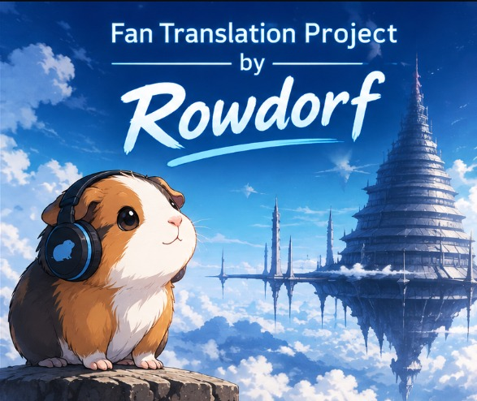
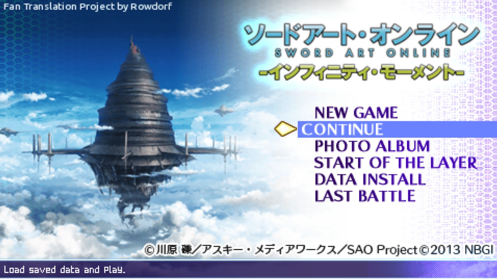
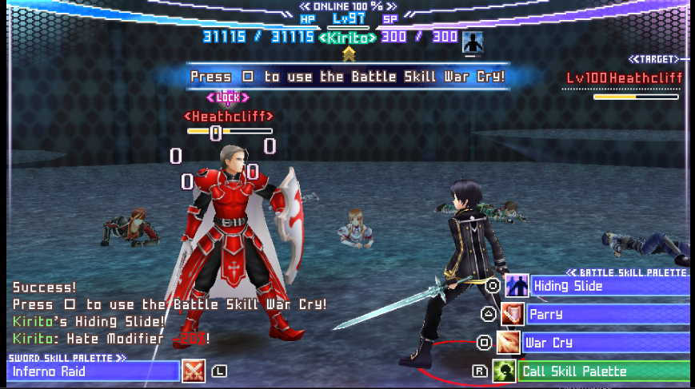
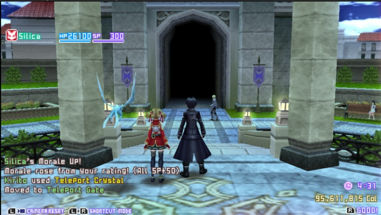
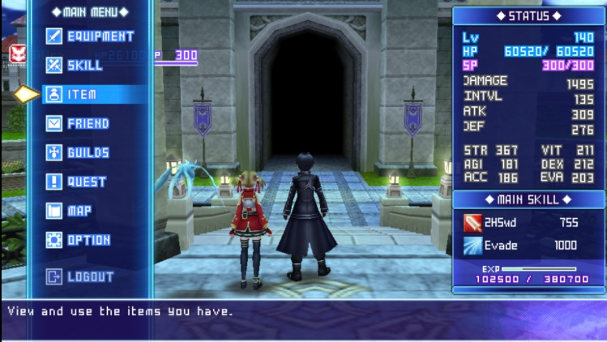
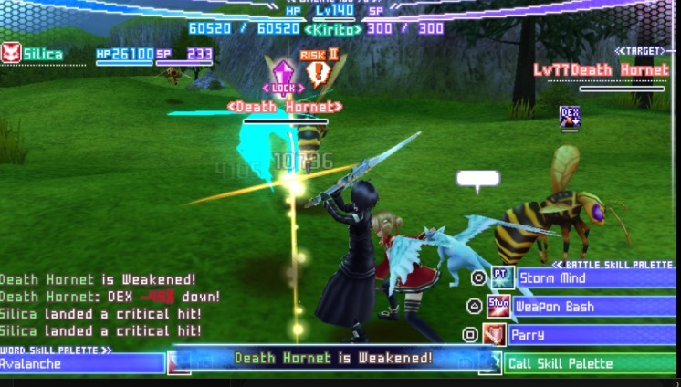

<p align="center">
  
</p>

<p align="center"><a href="README.md">English</a> | <b>Português (BR)</b></p>

# RowdyTranslation v1.0 — Sword Art Online: Infinity Moment (PSP) em português e inglês

**Fan Translation Project by Rowdorf**

<p align="center">
  
  
</p>
<p align="center">
  
  
</p>
<p align="center">
  
</p>

Tradução de fã de *Sword Art Online: Infinity Moment* (PSP, Japão, NPJH50701) para **português do Brasil** e
**inglês**. É distribuída **somente como patcher**: você precisa da sua própria ISO japonesa. **Este projeto não
distribui o jogo nem nenhum arquivo do jogo.** Compre o jogo original.

## Download
Baixe o pacote do seu sistema na página de [Releases](https://github.com/rowdorfin/RowdyTranslation/releases).
Este repositório e as suas releases são a **única** distribuição oficial; qualquer outra cópia pode ter sido alterada.

| sistema | arquivo |
|---|---|
| Windows 10/11 | `RowdyTranslationV1.0.zip` (janela, sem instalação) |
| Linux (x64 / ARM64) | `RowdyTranslationV1.0-linux.tar.gz` (terminal) |
| macOS (Intel / Apple Silicon) | `RowdyTranslationV1.0-macos.zip` (terminal) |

Os dois idiomas vêm em todos os pacotes; você escolhe um na hora de aplicar.

## Requisitos
- A sua ISO japonesa original, sem modificações:

| campo | valor esperado |
|---|---|
| jogo | Sword Art Online: Infinity Moment (PSP, Japão) |
| ID | NPJH-50701 (v1.00) |
| tamanho | 1.200.226.304 bytes |
| SHA-256 | `c8797943ee17f0b2b8e8b8bffdfd1189c75a569c90c5eed62722901d95f95ac4` |

- Cerca de 1,4 GB livres onde a ISO traduzida será salva. Funciona sem internet.
- Para jogar: PSP com firmware customizado (ARK-4, PRO ou ME) ou o emulador PPSSPP.

## Como usar
**Windows**
1. Extraia o `.zip` e rode **RowdyTranslationV1.0.exe**.
2. Escolha o idioma no topo: **Português (BR)** (a janela passa para português) ou **English**.
3. **Selecionar ISO...** → a sua ISO japonesa original. **Escolher destino...** → onde salvar.
4. Clique em **Instalar tradução em português** e aguarde alguns minutos. A ISO nova é conferida por SHA-256; a
   ISO original nunca é alterada. Para ter os dois idiomas, rode duas vezes e salve duas ISOs.

**Linux / macOS** (terminal)
```
./RowdyTranslationV1.0-linux-x64
```
O programa pergunta o idioma e os arquivos (dá para arrastar a ISO para a janela do terminal). Ou direto:
`./RowdyTranslationV1.0-linux-x64 --lang pt original.iso SAO_IM_PT_v1.0.iso`. No Mac, dê dois cliques em
`RowdyTranslationV1.0.command` (abre no Terminal). Ele não é notarizado pela Apple: se o macOS não deixar abrir,
clique com o botão direito > Abrir > Abrir (ou rode uma vez `xattr -d com.apple.quarantine RowdyTranslationV1.0.command`).
Veja o README dentro de cada pacote.

## Conferindo o download
Os programas **não têm assinatura digital**, então o SmartScreen/Defender do Windows ou o Gatekeeper do macOS podem
mostrar um aviso. Compare o SHA-256 com o `SHA256SUMS-release.txt` da página da release:
```
certutil -hashfile RowdyTranslationV1.0.exe SHA256
```

## Solução de problemas
| mensagem | o que fazer |
|---|---|
| "O arquivo selecionado não é uma imagem ISO" | Selecione a ISO japonesa (NPJH50701). CSO/ZIP/7z não são aceitos: extraia antes. |
| "Esta ISO não corresponde à versão japonesa original" / tamanho diferente | A sua ISO foi modificada ou é outro dump/versão (por exemplo, uma ISO já traduzida). Use um dump limpo. |
| Falta de espaço | Libere cerca de 1,4 GB ou escolha outro disco. |
| "Sem permissão para gravar" | Escolha uma pasta sua (Documentos, Área de Trabalho), não `C:\Windows` nem `Arquivos de Programas`. |
| "Os dados do patch estão corrompidos ou incompletos" | Baixe o pacote de novo e confira o hash. |
| Texto antigo/em japonês ou o outro idioma no jogo | Se você já usou o **Data Install** do jogo antes, apague os dados de instalação antigos (`PSP/SAVEDATA/NPJH50701INSTALL`) e instale de novo. Os saves podem ficar. |
| Outro problema | Anexe o log numa Issue: Windows `%LOCALAPPDATA%\RowdyTranslation\RowdyTranslation.log` (botão **Abrir log**), Linux `~/.cache/RowdyTranslation/RowdyTranslation.log`. |

O jogo traduzido precisa de firmware customizado ou do PPSSPP; não roda num PSP sem CFW.

## Novidades da v1.0
- Nova tradução em **português do Brasil**, junto com a de inglês.
- Legendas dos vídeos desenhadas pelo próprio jogo (vídeos originais intactos).
- Muitas correções feitas a partir de testes no PSP e no PPSSPP: menus, botões, textos da loja e do ferreiro,
  balões de fala da parceira (não são mais cortados em 19 caracteres), tela de resultado do chefe, diálogos do sistema.
- Patchers para Windows, Linux e macOS; a ISO traduzida agora tem ~1,3 GB (antes ~2,2 GB).

Lista completa no [CHANGELOG](CHANGELOG.md) (em inglês).

## Problemas conhecidos (v1.0)
- Textos desenhados dentro dos vídeos (a caixa de registro de personagem, a placa da sala do chefe) continuam em
  japonês.
- O logo do título é mantido com a arte japonesa original.
- Alguns rótulos de menu são abreviados para caber em campos de tamanho fixo.

## Ajude a melhorar a tradução!
Se você jogar, relate textos sem tradução, traduções estranhas, texto saindo da caixa ou comportamentos inesperados
nas [Issues](https://github.com/rowdorfin/RowdyTranslation/issues) (pode escrever em português). Capturas de tela e o
local exato (andar, área, menu ou evento) ajudam muito. Cada relato deixa a próxima versão melhor!

## Apoie o Rowdorf
Está gostando do projeto? Você pode apoiar o meu trabalho de tradução e projetos futuros com doações voluntárias.

☕ [**Apoie o Rowdorf no Ko-fi**](https://ko-fi.com/rowdorf)

Tem a ideia de um novo projeto ou um jogo que gostaria de ver traduzido? Deixe uma doação com uma mensagem ou conte
nas [Issues](https://github.com/rowdorfin/RowdyTranslation/issues). Doar é totalmente opcional.

## Créditos
- Tradução (português do Brasil e inglês), patch e patcher: **Rowdorf** (com auxílio de IA).
- Referências consultadas: a localização oficial em inglês de *SAO: Hollow Fragment* (terminologia); a tradução de fã
  anterior para inglês de **HoaiTrung97**; os guias de andares de hatsunumike.blogspot.com (nomes de áreas).
- *Sword Art Online* © Reki Kawahara / KADOKAWA / SAO Project; jogo © BANDAI NAMCO Games. Projeto de fã sem fins
  lucrativos, sem ligação com os detentores dos direitos.

## Licença
**Todos os direitos reservados.** Veja a [LICENSE](LICENSE). É proibido redistribuir, modificar, extrair ou reutilizar
a tradução, o patch ou o patcher, no todo ou em parte, sem autorização por escrito. É proibido vender o patcher, a
tradução ou uma ISO traduzida.
