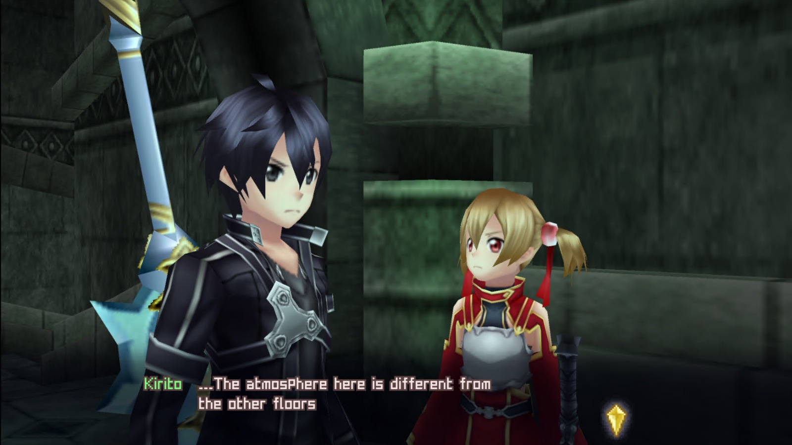

<p align="center">
  
</p>

<h1 align="center">RowdyTranslation v1.0</h1>

<p align="center">
  <b>Sword Art Online: Infinity Moment (PSP) — tradução de fã para português do Brasil e inglês</b><br>
  <sub>Fan Translation Project by Rowdorf</sub>
</p>

<p align="center">
  <a href="https://github.com/rowdorfin/RowdyTranslation/releases/latest"></a>
  
  
  
</p>

<p align="center">
  <a href="https://github.com/rowdorfin/RowdyTranslation/releases/latest"></a>
</p>

<p align="center"><a href="README.md">English</a> · <b>Português (BR)</b></p>

---

Jogue *Sword Art Online: Infinity Moment* (NPJH50701), lançado só no Japão para PSP, em **português do Brasil** ou
em **inglês**. Os textos do jogo, menus, diálogos do sistema e legendas dos vídeos estão traduzidos, e os dois
idiomas vêm num único patcher para Windows, Linux e macOS.

> [!IMPORTANT]
> Este projeto é **somente um patcher**. Você precisa da sua própria ISO japonesa original. **Este projeto não
> distribui o jogo nem nenhum arquivo do jogo.** Compre o jogo original.

## Capturas de tela
<sub>Capturas da versão em inglês.</sub>

<table>
  <tr>
    <td width="50%"></td>
    <td width="50%"></td>
  </tr>
  <tr>
    <td align="center"><sub>Tela de título</sub></td>
    <td align="center"><sub>Diálogo da história</sub></td>
  </tr>
  <tr>
    <td></td>
    <td></td>
  </tr>
  <tr>
    <td align="center"><sub>Batalha e paletas de skills</sub></td>
    <td align="center"><sub>Batalha contra chefe</sub></td>
  </tr>
  <tr>
    <td></td>
    <td></td>
  </tr>
  <tr>
    <td align="center"><sub>Menu principal e status</sub></td>
    <td align="center"><sub>Mensagens no campo</sub></td>
  </tr>
</table>

## Novidades da v1.0
- Nova tradução em **português do Brasil**, junto com a de inglês.
- Legendas dos vídeos desenhadas pelo próprio jogo (vídeos originais intactos).
- Muitas correções feitas a partir de testes no PSP e no PPSSPP: menus, botões, textos da loja e do ferreiro,
  balões de fala da parceira (não são mais cortados em 19 caracteres), tela de resultado do chefe, diálogos do sistema.
- Patchers para Windows, Linux e macOS; a ISO traduzida agora tem ~1,3 GB (antes ~2,2 GB).

Lista completa no [CHANGELOG](CHANGELOG.md) (em inglês).

## Download
Baixe o pacote do seu sistema na **[última release](https://github.com/rowdorfin/RowdyTranslation/releases/latest)**.
Este repositório e as suas releases são a **única** distribuição oficial; qualquer outra cópia pode ter sido alterada.

| Sistema | Arquivo | Interface |
|---|---|---|
| Windows 10/11 | `RowdyTranslationV1.0.zip` | janela, sem instalação |
| Linux (x64 / ARM64) | `RowdyTranslationV1.0-linux.tar.gz` | terminal |
| macOS (Intel / Apple Silicon) | `RowdyTranslationV1.0-macos.zip` | terminal |

Os dois idiomas vêm em todos os pacotes; você escolhe um na hora de aplicar. Funciona sem internet.

## Requisitos
A sua **ISO japonesa original, sem modificações**:

| Campo | Valor esperado |
|---|---|
| Jogo | Sword Art Online: Infinity Moment (PSP, Japão) |
| ID | NPJH-50701 (v1.00) |
| Tamanho | 1.200.226.304 bytes |
| SHA-256 | `c8797943ee17f0b2b8e8b8bffdfd1189c75a569c90c5eed62722901d95f95ac4` |

Arquivos CSO, ZIP e 7z não são aceitos: extraia a ISO antes. Você também precisa de cerca de **1,4 GB** livres onde a
ISO traduzida será salva.

## Como aplicar a tradução
O patcher confere a sua ISO por tamanho e SHA-256, **nunca altera a original** e confere a ISO nova por SHA-256 antes
de terminar. Para ter os dois idiomas, rode duas vezes e salve duas ISOs.

<details open>
<summary><b>Windows</b></summary>

1. Extraia o `.zip` e rode **RowdyTranslationV1.0.exe**.
2. Escolha o idioma no topo: **Português (BR)** (a janela passa para português) ou **English**.
3. **Selecionar ISO...** → a sua ISO japonesa original. **Escolher destino...** → onde salvar.
4. Clique em **Instalar tradução em português** e aguarde alguns minutos.

</details>

<details>
<summary><b>Linux</b></summary>

Extraia o `.tar.gz` e rode o programa no terminal (`-linux-x64` para PC comum, `-linux-arm64` para ARM de 64 bits).
Ele pergunta o idioma e os arquivos; dá para arrastar a ISO para a janela do terminal.

```bash
./RowdyTranslationV1.0-linux-x64
```

Ou passe tudo de uma vez (`--lang pt` ou `--lang en`):

```bash
./RowdyTranslationV1.0-linux-x64 --lang pt original.iso SAO_IM_PT_v1.0.iso
```

Se aparecer "permission denied", rode antes `chmod +x RowdyTranslationV1.0-linux-x64`.

</details>

<details>
<summary><b>macOS</b></summary>

1. Descompacte e dê dois cliques em **RowdyTranslationV1.0.command**. Ele abre no Terminal e pergunta o idioma e os
   arquivos (arraste a ISO para a janela do Terminal e aperte Enter).
2. O app **não é notarizado pela Apple**. Se o macOS não deixar abrir: clique com o botão direito > **Abrir** >
   **Abrir**, ou Ajustes do Sistema > Privacidade e Segurança > **Abrir Mesmo Assim**. Ou rode uma vez no Terminal:
   ```bash
   xattr -d com.apple.quarantine RowdyTranslationV1.0.command
   ```
3. Também dá para usar pelo Terminal: `./RowdyTranslationV1.0.command --lang pt original.iso SAO_IM_PT_v1.0.iso`.

</details>

Cada pacote também traz o seu próprio README.

### Conferindo o download
Os programas **não têm assinatura digital**, então o SmartScreen/Defender do Windows ou o Gatekeeper do macOS podem
mostrar um aviso. Compare o SHA-256 com o `SHA256SUMS-release.txt` da página da release:

```bash
certutil -hashfile RowdyTranslationV1.0.exe SHA256
```

No Linux use `sha256sum`; no macOS, `shasum -a 256`.

## Compatibilidade
- **PSP** com firmware customizado (ARK-4, PRO ou ME). O jogo traduzido **não** roda num PSP sem CFW.
- Emulador **PPSSPP**.
- As legendas dos vídeos são compatíveis com códigos CWCheat.

Se você já usou o **Data Install** do jogo antes de aplicar a tradução, apague os dados de instalação antigos
(`PSP/SAVEDATA/NPJH50701INSTALL`) e instale de novo. Os saves podem ficar.

<details>
<summary><b>Solução de problemas</b></summary>

| Mensagem | O que fazer |
|---|---|
| "O arquivo selecionado não é uma imagem ISO" | Selecione a ISO japonesa (NPJH50701). CSO/ZIP/7z não são aceitos: extraia antes. |
| "Esta ISO não corresponde à versão japonesa original" / tamanho diferente | A sua ISO foi modificada ou é outro dump/versão (por exemplo, uma ISO já traduzida). Use um dump limpo. |
| Falta de espaço | Libere cerca de 1,4 GB ou escolha outro disco. |
| "Sem permissão para gravar" | Escolha uma pasta sua (Documentos, Área de Trabalho), não `C:\Windows` nem `Arquivos de Programas`. |
| "Os dados do patch estão corrompidos ou incompletos" | Baixe o pacote de novo e confira o hash. |
| Texto antigo/em japonês ou o outro idioma no jogo | Apague o Data Install antigo (`PSP/SAVEDATA/NPJH50701INSTALL`) e instale de novo. Os saves podem ficar. |
| Outro problema | Anexe o log numa Issue (veja [Como relatar problemas](#como-relatar-problemas)). |

Arquivos de log: Windows `%LOCALAPPDATA%\RowdyTranslation\RowdyTranslation.log` (botão **Abrir log**),
Linux `~/.cache/RowdyTranslation/RowdyTranslation.log`, macOS `~/Library/Caches/RowdyTranslation/RowdyTranslation.log`.

</details>

## Problemas conhecidos (v1.0)
- Textos desenhados dentro dos vídeos (a caixa de registro de personagem, a placa da sala do chefe) continuam em
  japonês.
- O logo do título é mantido com a arte japonesa original.
- Alguns rótulos de menu são abreviados para caber em campos de tamanho fixo.

## Como relatar problemas
Encontrou texto sem tradução, uma frase estranha, texto saindo da caixa ou algo inesperado? Abra uma
**[Issue](https://github.com/rowdorfin/RowdyTranslation/issues)** (pode escrever em português). Os relatos mais úteis
trazem:
- o **idioma** (português ou inglês) e onde você joga (**PSP com CFW** ou **PPSSPP**);
- o **local** exato: andar, área, menu ou evento;
- uma **captura de tela**;
- em problemas do patcher, o **arquivo de log** (caminhos em Solução de problemas).

Cada relato deixa a próxima versão melhor!

## Apoie o Rowdorf
Está gostando do projeto? Você pode apoiar o meu trabalho de tradução e projetos futuros com doações voluntárias.

<p align="center">
  <a href="https://ko-fi.com/rowdorf"></a>
</p>

Tem a ideia de um novo projeto ou um jogo que gostaria de ver traduzido? Deixe uma doação com uma mensagem ou conte
nas [Issues](https://github.com/rowdorfin/RowdyTranslation/issues). Doar é totalmente opcional.

## Créditos
- Tradução (português do Brasil e inglês), patch e patcher: **Rowdorf** (com auxílio de IA).
- Referências consultadas: a localização oficial em inglês de *SAO: Hollow Fragment* (terminologia); a tradução de fã
  anterior para inglês de **HoaiTrung97**; os guias de andares de hatsunumike.blogspot.com (nomes de áreas).
- *Sword Art Online* © Reki Kawahara / KADOKAWA / SAO Project; jogo © BANDAI NAMCO Games. Projeto de fã sem fins
  lucrativos, sem ligação com os detentores dos direitos.

## Licença
**Todos os direitos reservados.** Veja a [LICENSE](LICENSE). É proibido redistribuir, modificar, extrair ou reutilizar
a tradução, o patch ou o patcher, no todo ou em parte, sem autorização por escrito. É proibido vender o patcher, a
tradução ou uma ISO traduzida.
